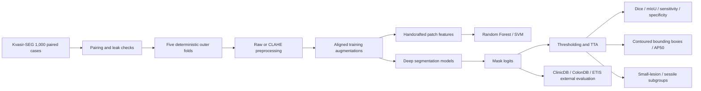
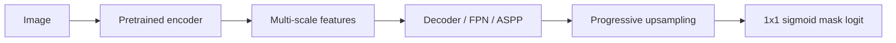
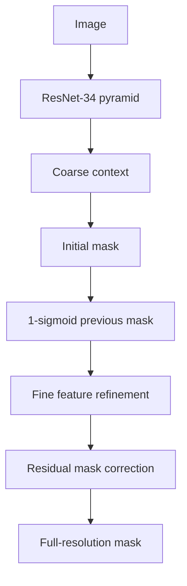
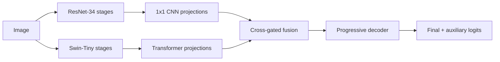
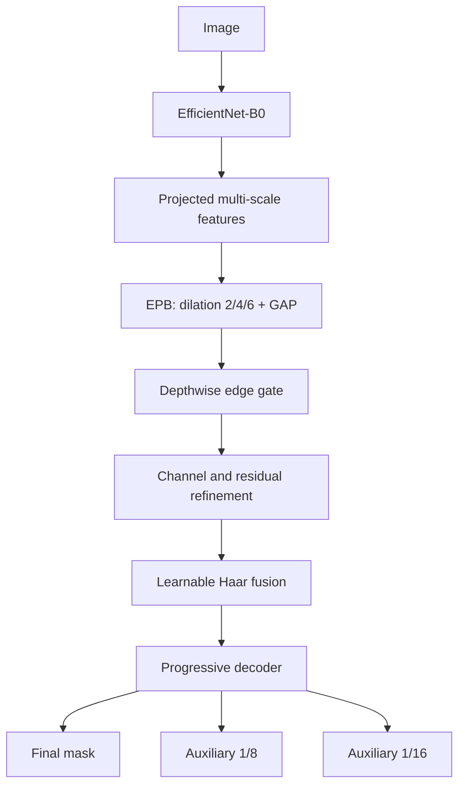
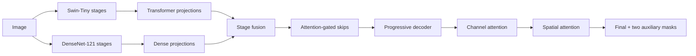
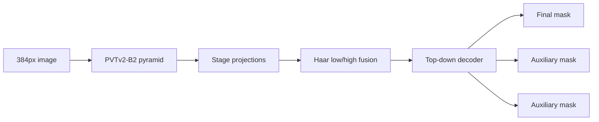

# Colorectal Polyp Segmentation: End-to-End Research Pipeline

**Academic scope:** AI-driven polyp detection, segmentation, localization, and feature characterization.

**Primary dataset:** Kvasir-SEG, 1,000 paired colonoscopy images and binary masks.

**Primary protocol:** strict image-level five-fold cross-validation, seed 42,
352 x 352 or 384 x 384 inputs, fixed outer test folds, inner-validation
checkpoint/threshold selection, and held-out external evaluation.

> **Research use only.** This repository is not a medical device and is not
> validated for diagnosis, screening, patient triage, or clinical deployment.
> Kvasir-SEG is polyp-positive; it does not provide normal-patient controls,
> patient/procedure identifiers, or clinical specificity.

---

## 1. Project Summary

This project evaluates the complete polyp-analysis chain:

1. dataset pairing and leakage control;
2. image cleaning, normalization, and augmentation;
3. patch-level handcrafted feature baselines;
4. standard CNN, transformer, hybrid, and lightweight segmentation models;
5. multi-scale and boundary-aware losses;
6. contour-derived bounding boxes and object-detection metrics;
7. small-lesion and sessile-subgroup analysis;
8. held-out external evaluation;
9. resumable checkpointing and reproducible reporting.

The current strict-CV headline result is a
**Swin-Tiny + DenseNet-121 Attention U-Net** with
**0.895872 +/- 0.007585 mean TTA Dice**. PVTv2-B2 + Haar-FPN achieved
**0.893765 +/- 0.007451 mean TTA Dice** but was faster and substantially better
on several external cohorts.



---

## 2. Data and Split Protocol

### 2.1 Kvasir-SEG

The primary benchmark uses 1,000 paired Kvasir-SEG images and binary masks.
The loader validates:

- exact basename pairing;
- readable images and masks;
- matching image/mask dimensions;
- image-width and height metadata;
- available bounding-box annotations;
- no exact-pixel overlap between train, inner-validation, and outer-test folds.

Kvasir-SEG provides static polyp-positive images. It does not provide patient,
procedure, video-sequence, or normal-patient control identifiers.

### 2.2 Five-fold partition

For every outer fold:

- approximately 800 training/inner-validation images;
- 10% inner-validation partition;
- 200 untouched outer-test images;
- seed 42;
- image-level splitting;
- outer-test images used once after checkpoint and threshold selection.

Fold manifests record case IDs and auxiliary/exclusion metadata.
An inner validation threshold is selected only from the inner-validation subset.
The chosen threshold is then applied unchanged to the outer fold.

### 2.3 External datasets

The Zenodo PolypDataset archive supplied:

| Dataset | Images | Exact duplicate pairs retained |
|---|---:|---:|
| CVC-ClinicDB test | 62 | 0 |
| CVC-ColonDB test | 380 | 34 |
| ETIS-LaribPolypDB test | 196 | 3 |
| Auxiliary CVC-ClinicDB training | 550 | excluded from test sets |

The external datasets are used for held-out model variation and generalization
analysis, not clinical validation. ColonDB and ETIS duplicate-pair observations
are not independent image cases.

### 2.4 HyperKvasir

A seeded 1,000-image image-only HyperKvasir sample was downloaded and verified.
All files passed published size/SHA-256 checks and OpenCV decoding. Exact
decoded-pixel overlap was checked against all Kvasir-SEG cases and the external
test cohorts; all 1,000 remained eligible. HyperKvasir is a heterogeneous
gastrointestinal corpus and is not guaranteed to contain colon-only frames.

---

## 3. Preprocessing and Data Augmentation

### 3.1 Preprocessing modes

**Raw RGB**

- RGB conversion;
- preserve or normalize image values;
- no Telea inpainting;
- no CLAHE.

**CLAHE**

- bright, low-saturation highlights identified in HSV;
- median blur;
- Telea inpainting of specular highlights;
- CIELAB conversion;
- CLAHE on the L channel;
- clip limit 2.0;
- 8 x 8 tiles;
- conversion back to RGB.

Raw and CLAHE are comparable preprocessing conditions. Later controls added:

- `--clahe-probability`: optional training-only probabilistic CLAHE;
- `--preserve-aspect-ratio`: resize-and-pad instead of aspect-ratio squashing;
- `--freeze-encoder-batchnorm`: stops encoder BatchNorm running-stat updates;
- `--encoder-learning-rate`: separates pretrained encoder and decoder learning rates.

Validation, outer-test, and external inputs remain deterministic.

### 3.2 Geometric and photometric augmentation

Training augmentation uses the same transform for paired image and mask:

- horizontal flip, probability 0.5;
- vertical flip, probability 0.5;
- random 90-degree rotations;
- contrast multiplier 0.85--1.15;
- brightness shift -12 to +12;
- optional hue shift -8 to +8;
- optional saturation multiplier 0.9--1.1;
- aligned random zoom/crop;
- mild Gaussian blur;
- train-only 50% small-lesion crop for boxes <=2% of frame;
- elastic/grid/affine deformation is planned as a future study.

Random zoom resizes the crop for the image and mask using linear and nearest-
neighbor interpolation respectively. Blur is applied only to the image.

### 3.3 Handcrafted feature extraction

Images are divided into a 4 x 4 patch grid, producing 16 descriptors per image.
Ground-truth masks create labels only; descriptors do not read masks.

Features include:

- HSV means, standard deviations, and 8-bin histograms;
- CIELAB means, standard deviations, and 8-bin histograms;
- GLCM contrast, homogeneity, energy, and correlation;
- uniform LBP histogram, P=8, R=1;
- Canny edge fraction;
- Sobel gradient statistics;
- contour area fraction;
- circularity and aspect-ratio proxies.

These features support Random Forest and RBF-SVM patch classifiers.

---

## 4. Loss Functions

The training objective registry includes:

| Loss | Intended role |
|---|---|
| BCE | Pixel classification baseline |
| BCE + Dice | Region-overlap and pixel balance |
| Weighted BCE + weighted IoU | Boundary-sensitive structure weighting |
| Focal Tversky | False-negative emphasis |
| Dice + boundary | Signed-distance boundary refinement |
| BCE + Dice + boundary | Region and boundary supervision |
| BCE + Dice + boundary + edge | Separate edge-head supervision |
| Small-lesion weighted BCE + Dice | Area-sensitive small-polyp weighting |

Deep-supervision models minimize weighted auxiliary losses:

```text
L = L_final + 0.4 L_1/8 + 0.2 L_1/16
```

The signed-distance implementation was a CPU-to-torch distance map, while the
edge implementation used morphological edge maps and BCE/Dice terms.

---

## 5. Architecture Families

## 5.1 Classical segmentation baselines

Random Forest and RBF-SVM operate on 4 x 4 patch grids.

| Model | Dice | Sensitivity | Specificity | AP50 |
|---|---:|---:|---:|---:|
| Random Forest | 0.505 +/- 0.020 | 0.721 +/- 0.036 | 0.788 +/- 0.011 | 0.093 +/- 0.019 |
| RBF-SVM | 0.468 +/- 0.018 | 0.878 +/- 0.023 | 0.650 +/- 0.007 | 0.070 +/- 0.014 |

These are patch classifiers, not full-resolution end-to-end segmenters.

## 5.2 Standard CNN and transformer baselines

The completed baseline models include:

- U-Net with EfficientNet-B0, ResNet-34, or ResNet-50;
- U-Net++ with EfficientNet-B0, ResNet-34, or ResNet-50;
- FPN with ResNet-34;
- DeepLabV3+ with ResNet-34;
- SegFormer MiT-B0;
- UPerNet MiT-B0.



The strongest completed pretrained baseline was FPN/ResNet-34 with TTA.

| Model | Dice | TTA Dice | mIoU | Sensitivity | FPS |
|---|---:|---:|---:|---:|---:|
| FPN / ResNet-34 | 0.885 +/- 0.013 | 0.895 +/- 0.016 | 0.818 +/- 0.017 | 0.881 +/- 0.028 | 51.8 |
| DeepLabV3+ / ResNet-34 | 0.886 +/- 0.008 | 0.894 +/- 0.007 | 0.821 +/- 0.009 | 0.888 +/- 0.018 | 50.2 |
| SegFormer / MiT-B0 | 0.881 +/- 0.011 | 0.888 +/- 0.008 | 0.811 +/- 0.013 | 0.881 +/- 0.025 | 59.6 |

The raw/CLAHE ablation on U-Net/ResNet-34 found:

| Input | Loss | Dice |
|---|---|---:|
| Raw | BCE | 0.799 +/- 0.014 |
| Raw | BCE+Dice | 0.815 +/- 0.040 |
| CLAHE | BCE | 0.797 +/- 0.017 |
| CLAHE | BCE+Dice | 0.829 +/- 0.018 |

Weighted BCE+IoU reached Dice 0.839 +/- 0.023 on the original scratch CNN
benchmark.

## 5.3 PraNet-style reverse-attention model

PraNet-style uses:

- pretrained ResNet-34 pyramidal features;
- coarse-to-fine reverse-attention refinements;
- residual delta mask heads;
- optional auxiliary deep-supervision logits.



The best PraNet-style Kvasir-only configuration reached 0.883 TTA Dice
with no deep supervision or small-lesion crop.

## 5.4 TransFuse-style CNN/Transformer hybrid

TransFuse-style uses parallel CNN and Swin-Tiny feature pyramids, projected
to shared 64-channel features, reciprocal cross-gating, and progressive decoder
upsampling.



The completed Kvasir-only TransFuse result with deep supervision and 50% crop
was 0.884 ordinary and 0.892 TTA Dice.

## 5.5 MFPS-Net

MFPS-Net combines:

- pretrained ResNet-34 FPN levels;
- learned Haar low/high-frequency fusion;
- global-local feature interaction;
- auxiliary edge head;
- independent edge-loss weight.

Its eight-cell Haar/global-local/edge factorial is C0--C7.
Completed C0 and C1 results were ordinary/TTA 0.8784/0.8863 and
0.8725/0.8867 Dice. MFPS-Net v1 completed at 0.8775 ordinary and
0.8858 TTA Dice.

## 5.6 EfficientPolySeg-inspired hybrid

EfficientPolySeg is an inspired implementation, not a reproduction or
paper checkpoint.

Components:

- EfficientNet-B0 encoder;
- parallel dilated context rates 2, 4, 6;
- global average pooled branch;
- depthwise/pointwise edge gate;
- multiplicative skip-style refinement;
- squeeze-excitation channel recalibration;
- learned Haar skip fusion;
- final and auxiliary heads.



The local model contains 4.178M parameters and 1.405 GFLOPs at 352 x 352.
The one-fold pilot reached 0.8694 TTA Dice. The 80-epoch five-fold run was
paused after folds 1--4 and fold 5 epoch 1, so it has no completed five-fold
performance claim.

## 5.7 Swin-Tiny + DenseNet-121 Attention U-Net

This was the highest strict-CV Kvasir model.

Architecture:

- pretrained Swin-Tiny hierarchical transformer encoder;
- pretrained DenseNet-121 local-feature encoder;
- four projected 64-channel stages;
- cross-stage Swin/DenseNet concatenation and convolution fusion;
- Attention U-Net-style gating;
- decoder channel squeeze-excitation;
- decoder 7 x 7 spatial attention;
- deep-supervision heads.



Five-fold strict-CV results:

| Metric | Ordinary | TTA |
|---|---:|---:|
| Dice | 0.889415 +/- 0.004659 | 0.895872 +/- 0.007585 |
| mIoU | 0.826575 +/- 0.004448 | 0.835335 +/- 0.007200 |
| Sensitivity | 0.883811 +/- 0.022062 | 0.890646 +/- 0.020264 |
| Specificity | 0.984020 +/- 0.003797 | 0.985852 +/- 0.003498 |
| AP50 | 0.874915 +/- 0.010003 | 0.881955 +/- 0.016016 |
| Box precision | 0.842016 +/- 0.026705 | 0.861171 +/- 0.024327 |
| Box recall | 0.887150 +/- 0.011917 | 0.893776 +/- 0.015050 |
| FPS | 16.00 +/- 0.30 | 4.52 +/- 0.09 |

The 13-case <=2% box subgroup scored 0.6855 ordinary / 0.7054 TTA Dice.
It remains high variance.

## 5.8 PVTv2-B2 + Haar-FPN

PVTv2-B2 + Haar-FPN is a single-encoder hierarchical transformer experiment:

- PVTv2-B2 four-stage pyramid;
- 64-channel stage projections;
- fixed 2D Haar low/high-frequency fusion;
- progressive FPN-style decoder;
- weighted BCE + weighted IoU;
- two auxiliary heads;
- 384 x 384 aspect-preserved input.



Measured complexity: 25.365M parameters and 13.044 GFLOPs at 384 x 384.

Five-fold strict-CV results:

| Metric | Ordinary | TTA |
|---|---:|---:|
| Dice | 0.887625 +/- 0.005397 | 0.893765 +/- 0.007451 |
| mIoU | 0.825423 +/- 0.008723 | 0.833163 +/- 0.009955 |
| Sensitivity | 0.880117 +/- 0.022663 | 0.881961 +/- 0.025685 |
| Specificity | 0.987460 +/- 0.002518 | 0.988727 +/- 0.003209 |
| AP50 | 0.851736 +/- 0.014060 | 0.862582 +/- 0.017690 |
| FPS | 33.11 +/- 3.85 | 8.25 +/- 1.04 |

It does not beat Swin-DenseNet in paired five-fold TTA Dice (p=0.5527),
but it is faster and generalizes strongly to external cohorts.

---

## 6. Localization and Detection

Predicted masks are thresholded and passed through OpenCV contour extraction.

1. probability threshold;
2. binary foreground mask;
3. connected-component cleanup;
4. component box extraction;
5. `>=0.5` IoU greedy matching;
6. bounding-box precision and recall;
7. AP50 over component mean mask scores.

Reported metrics:

- Dice;
- mIoU;
- sensitivity;
- pixel specificity;
- AP50;
- box precision;
- box recall;
- ordinary/TTA FPS.

Pixel specificity is not patient-level specificity because Kvasir-SEG contains
no normal-patient control cohort.

---

## 7. TTA and Post-Processing

The standard TTA averages probabilities from four transformed views.
It generally improves mean Dice but lowers FPS.

Post-processing implemented and documented:

- fixed probability threshold;
- inner-validation threshold search 0.35--0.65;
- four-view probability averaging;
- connected-component box extraction;
- validation-only threshold metadata.

DenseCRF was not completed in the Windows environment.

---

## 8. Joint-Training and External Results

PraNet-style and TransFuse-style models were jointly trained on each fold's
Kvasir training portion plus 550 ClinicDB auxiliary cases.

| External set | Best ordinary joint Dice | Best TTA joint Dice |
|---|---:|---:|
| ClinicDB | 0.854 +/- 0.029 TransFuse | 0.854 +/- 0.026 PraNet |
| ColonDB | 0.713 +/- 0.039 TransFuse | 0.719 +/- 0.029 TransFuse |
| ETIS-LaribPolypDB | 0.623 +/- 0.052 TransFuse | 0.645 +/- 0.018 PraNet |

The PVTv2-B2 Kvasir-only five-checkpoint external result was stronger than
Swin-DenseNet in ColonDB and ETIS:

| External set | Swin-DenseNet TTA | PVTv2-B2 TTA | Paired difference | p |
|---|---:|---:|---:|---:|
| ClinicDB | 0.7492 +/- 0.0128 | 0.7814 +/- 0.0170 | +0.0322 | 0.0675 |
| ColonDB | 0.6346 +/- 0.0237 | 0.7317 +/- 0.0071 | +0.0972 | 0.0004 |
| ETIS-LaribPolypDB | 0.5234 +/- 0.0363 | 0.6498 +/- 0.0387 | +0.1264 | 0.0031 |

These external gains are promising but are measured over the same five fixed
external sets with fold-specific checkpoints.

---

## 9. Frequency, Boundary, and EMA Ablations

A matched TransFuse frequency/boundary comparison produced:

| Condition | Ordinary Dice | TTA Dice |
|---|---:|---:|
| Matched BCE+Dice | 0.8787 +/- 0.0180 | 0.8879 +/- 0.0177 |
| Spatial boundary loss | 0.8738 +/- 0.0218 | 0.8827 +/- 0.0190 |
| Fixed Haar + boundary | 0.8891 +/- 0.0067 | 0.8948 +/- 0.0095 |
| Haar + boundary + EMA consistency | 0.8782 +/- 0.0208 | 0.8851 +/- 0.0177 |

Haar frequency fusion improved TTA Dice, while the spatial boundary arm and
EMA consistency arm did not establish gains.

The ten-epoch HyperKvasir Mean Teacher-style experiment scored:

| Condition | Ordinary Dice | TTA Dice |
|---|---:|---:|
| Supervised control | 0.8747 +/- 0.0082 | 0.8839 +/- 0.0055 |
| EMA + HyperKvasir consistency | 0.8786 +/- 0.0105 | 0.8869 +/- 0.0114 |

The paired gain was small and noisy. It did not improve the small-box subgroup
and did not isolate unlabeled-pseudo-label contribution from EMA regularization.

## 10. Small-Lesion Ablation

The `bce_dice_small_focus` loss weighted false-negative and positive-pixel
errors for masks occupying at most 5% of a frame.

Five-fold result:

| Arm | Ordinary Dice | TTA Dice | Sensitivity | TTA sensitivity |
|---|---:|---:|---:|---:|
| Ordinary BCE+Dice | 0.8894 +/- 0.0047 | 0.8959 +/- 0.0076 | 0.8838 +/- 0.0221 | 0.8906 +/- 0.0203 |
| Small-focus BCE+Dice | 0.8906 +/- 0.0129 | 0.8947 +/- 0.0123 | 0.8856 +/- 0.0156 | 0.8913 +/- 0.0114 |

The paired differences were not significant. The <=2% TTA subgroup decreased
from 0.7054 +/- 0.2970 to 0.6342 +/- 0.3372, and external scores were lower.
The arm is retained only as a documented ablation.

---

## 11. Bottleneck Audit

The strongest bottleneck evidence is:

1. **Pretraining produced a large baseline gain.**
2. **Stronger feature representations consistently outperformed custom decoder tricks**
   on this 4 GB hardware.
3. **Fixed Haar frequency fusion was useful.**
4. **Small-lesion losses did not create a reliable gain.**
5. **EMA consistency was modest and noisy.**
6. **Validation/checkpoint variance is substantial in 80--200-image folds.**
7. **TTA improved accuracy but reduced FPS.**
8. **External generalization was architecture-dependent.**

Controlled fold-1 diagnostics compared raw/384 weighted-BCE+IoU against the
Swin-DenseNet hybrid:

| Fold-1 configuration | Ordinary Dice | TTA Dice |
|---|---:|---:|
| FPN/ResNet-34 raw + weighted BCE+IoU | 0.8367 | 0.8466 |
| FPN/ResNet-34 raw + BCE+Dice | 0.8343 | 0.8433 |
| Swin-DenseNet hybrid CLAHE + BCE+Dice | 0.8886 | 0.8968 |

The evidence does not support the claim that preprocessing, resolution,
BatchNorm freezing, or weighted loss alone replaces stronger visual priors.

---

## 12. Highest Completed Results

### Strict Kvasir-SEG five-fold results

| Category | Highest completed result |
|---|---|
| Strict-CV TTA Dice | 0.895872 +/- 0.007585, Swin-DenseNet Attention U-Net |
| Strict-CV ordinary Dice | 0.889415 +/- 0.004659, Swin-DenseNet Attention U-Net |
| Pretrained CNN TTA Dice | 0.8950 +/- 0.0160, FPN/ResNet-34 |
| Frequency/boundary TTA Dice | 0.8948 +/- 0.0095, TransFuse-Haar-boundary |
| PVTv2 strict-CV TTA Dice | 0.893765 +/- 0.007451 |
| Small-box TTA Dice | 0.722756 +/- 0.242127, PVTv2-B2 |

### External TTA Dice

| Dataset | Highest measured completed result |
|---|---:|
| ClinicDB joint training | 0.854 +/- 0.026 PraNet-style |
| ClinicDB Kvasir-only PVTv2 | 0.781357 +/- 0.017026 |
| ColonDB joint training | 0.719 +/- 0.029 TransFuse-style |
| ColonDB Kvasir-only PVTv2 | 0.731737 +/- 0.007131 |
| ETIS joint training | 0.645 +/- 0.018 PraNet-style |
| ETIS Kvasir-only PVTv2 | 0.649760 +/- 0.038697 |

The strict-CV and joint-training rows are different protocols and must not be
combined into a single ranking.

---

## 13. Reproducibility

### Recommended environment

- Python 3.11;
- PyTorch 2.5.1+cu121;
- segmentation-models-pytorch;
- timm;
- OpenCV;
- scikit-learn;
- scikit-image;
- THOP;
- Matplotlib.

### Core commands

```powershell
# Classical baselines
python -m polyp_pipeline classical `
  --dataset-root "kvasir-seg\Kvasir-SEG" `
  --output-dir runs --folds 5 --seed 42 --preprocessing clahe

# Full CNN/transformer benchmark
python -m polyp_pipeline benchmark `
  --dataset-root "kvasir-seg\Kvasir-SEG" `
  --output-dir runs --folds 5 --seed 42 --size 352 `
  --batch-size 4 --epochs 30 --patience 6 --device cuda

# Swin-DenseNet five-fold run
python -m polyp_pipeline train `
  --dataset-root "kvasir-seg\Kvasir-SEG" `
  --output-dir "D:\PolypRuns\swin_densenet_attention_full" `
  --model swin_densenet121_attn_unet --loss bce_dice `
  --preprocessing clahe --folds 5 --seed 42 --size 352 `
  --batch-size 2 --gradient-accumulation-steps 4 `
  --epochs 50 --patience 12 --scheduler cosine --warmup-epochs 3 `
  --deep-supervision --pretrained-encoder --test-time-augmentation `
  --device cuda --num-workers 0 --no-overlays --no-predictions

# PVTv2-B2 five-fold run
python -m polyp_pipeline train `
  --dataset-root "kvasir-seg\Kvasir-SEG" `
  --output-dir "D:\PolypRuns\pvt_v2_b2_haar_fpn_full" `
  --model pvt_v2_b2_haar_fpn --loss weighted_bce_iou `
  --preprocessing clahe --folds 5 --seed 42 --size 384 `
  --batch-size 2 --gradient-accumulation-steps 4 `
  --preserve-aspect-ratio --freeze-encoder-batchnorm `
  --deep-supervision --pretrained-encoder --test-time-augmentation `
  --device cuda --num-workers 0 --no-overlays --no-predictions

# Generate reports
python -m polyp_pipeline report `
  --input-dir "D:\PolypRuns\swin_densenet_attention_full" `
  --output-dir "reports\swin_densenet_attention_full"
```

Checkpoints, folds, progress logs, and external metadata are written outside
Git by default. Resume identical configurations; incompatible resume settings
are rejected.

---

## 14. Known Limitations

- no patient/procedure identifiers;
- no normal-patient specificity cohort;
- 13 highly variable <=2% lesion cases;
- no DenseCRF measured result;
- no completed EfficientPolySeg five-fold result;
- MFPS C2--C7 factorial cells remain incomplete;
- no independent multi-center clinical validation;
- no confidence intervals or clinical significance claims;
- some 900/100 and 80/10/10 literature scores are not protocol-matched;
- external checkpoint SD is not independent external-cohort uncertainty;
- FPS is hardware-dependent model-only throughput;
- PVTv2 and Swin-DenseNet Kvasir differences are not statistically significant;
- joint-training and Kvasir-only external sets are not interchangeable.

---

## 15. Repository Report Index

| Report | Purpose |
|---|---|
| [full benchmark](reports/full_benchmark/) | scratch and standard deep learning baselines |
| [advanced benchmark](reports/advanced_benchmark/) | pretrained CNN/transformer and loss ablations |
| [specialized benchmark](reports/specialized_benchmark/) | PraNet and TransFuse-style models |
| [joint external benchmark](reports/external_joint/) | 550-case ClinicDB joint training |
| [frequency boundary](reports/frequency_boundary/) | Haar/boundary/EMA ablations |
| [MFPS factorial](reports/mfps_ablation_full/) | C0/C1 completed factorial comparison |
| [MFPS-Net v1](reports/mfps_net_v1/) | completed MFPS-Net result |
| [EfficientPolySeg pilot](reports/efficient_polyseg_pilot/) | one-fold pilot |
| [Swin-DenseNet full](reports/swin_densenet_attention_full/) | highest strict-CV result |
| [Swin-DenseNet pilot](reports/swin_densenet_attention_pilot/) | fold-1 pilot |
| [small-focus full](reports/swin_densenet_small_focus_full/) | small-lesion loss ablation |
| [PVTv2 full](reports/pvt_v2_b2_haar_fpn_full/) | PVTv2 capacity and external comparison |
| [PVTv2 pilot](reports/pvt_v2_b2_haar_fpn_pilot/) | PVTv2 fold-1 pilot |
| [HyperKvasir comparison](reports/hyperkvasir_comparison/) | unlabeled/EMA pilot |

---

## 16. Ethical and Academic Scope

This repository demonstrates machine-learning methods for colonoscopy image
analysis. It does not provide clinical evidence of diagnostic accuracy,
sensitivity/specificity for disease, or safety. Reported specificity is
pixel-level overlap against polyp masks within positive images. Future clinical
deployment would require patient-level data, blinded clinical studies,
prospective validation, calibration, uncertainty analysis, fairness testing,
and regulatory review.
